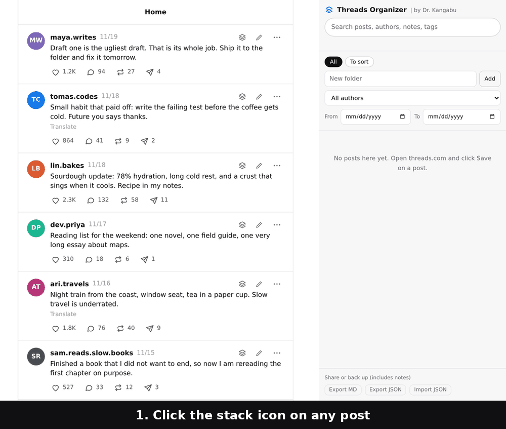
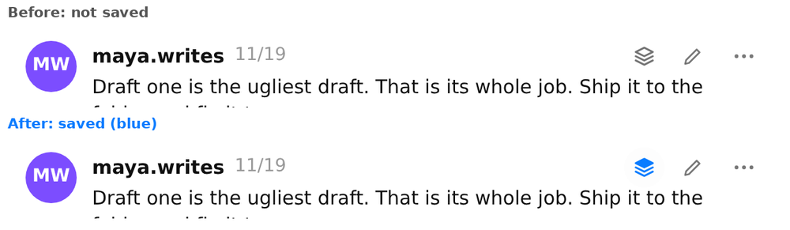
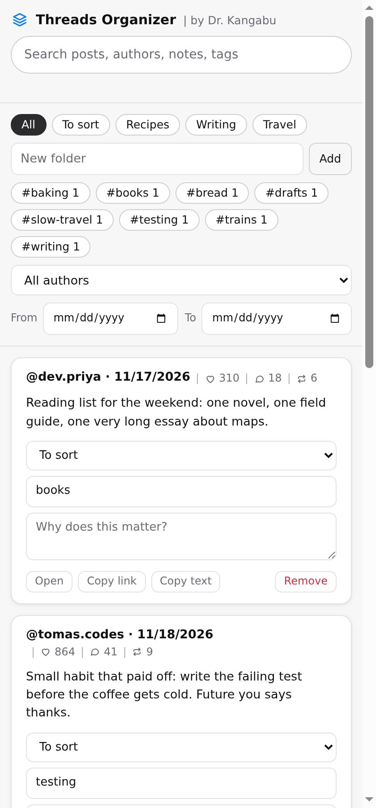
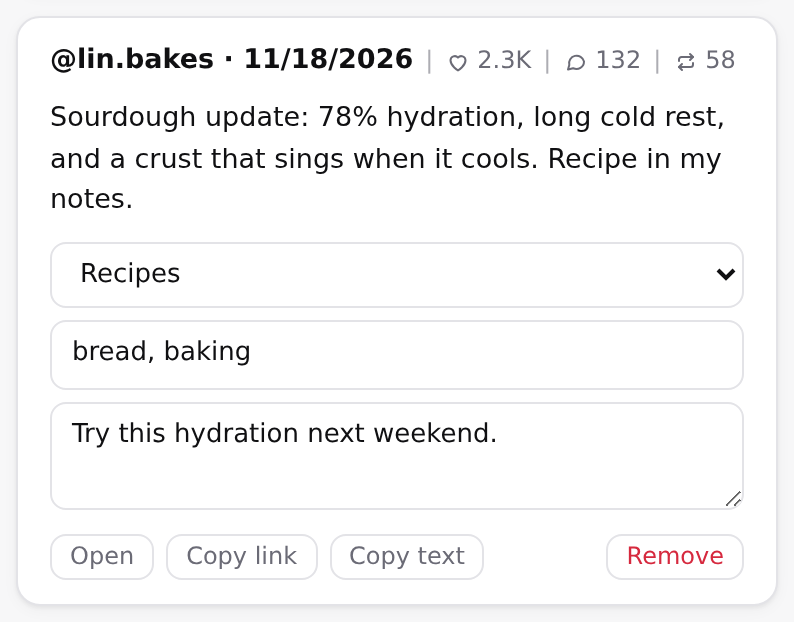
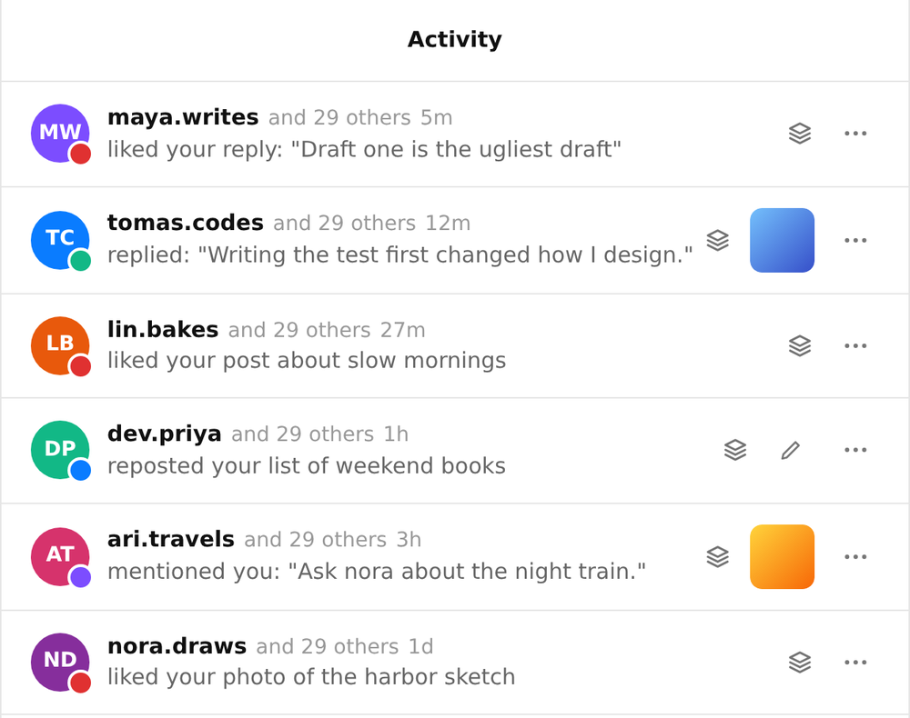

# Threads Organizer | by Dr. Kangabu

Threads Organizer is a Chrome extension for threads.com and threads.net. It adds a stack-of-cards button to each post. Saved posts appear in a side panel, where you sort them into folders, tag them, add notes, search them, and export them as Markdown or JSON.

## What it looks like

Screenshots are generated from the real extension running on a mock Threads-style page with fictional users (see tools/screenshots). Threads' real page layout may differ slightly.

## Documentation

| Guide | Audience | Content |
| --- | --- | --- |
| [User guide](docs/user-guide.md) | Anyone using the extension | Install, update, save, organize, search, export, restore, remove data |
| [Troubleshooting](docs/troubleshooting.md) | Anyone using the extension | Symptoms, checks, how to write a useful bug report |
| [Maintainer guide](docs/maintainer-guide.md) | Contributors | Dev setup, tests, fixing broken selectors, releases, publication |

## Quick start

1. Download the latest ZIP from the repository's **Releases** page and extract it into a new folder, or clone the repository.
2. Open `chrome://extensions` in Chrome.
3. Turn on **Developer mode** (top right).
4. Click **Load unpacked** and select the folder that contains `manifest.json`.
5. Pin the extension, open threads.com, and click the extension icon to open the side panel.

Details and update steps: [User guide](docs/user-guide.md).

## Privacy

The extension makes no network requests of its own and has no account or server. The only outside link is the "Dr. Kangabu" credit in the panel title, which opens the author's website in a new tab when you click it. It stores saved posts, folders, tags and notes in `chrome.storage.local` on your device. Its permissions are `storage`, `sidePanel` and `unlimitedStorage`, with host access to `*.threads.com` and `*.threads.net` only. The extension never sends your library anywhere; it leaves your device only when you export a file yourself, and exports include your private notes, tags and folder names, so review a file before you share it. The save button sits in the Threads page, so scripts running on threads.com can see which visible posts are marked as saved; they cannot read your library, notes or tags.

## License

MIT. See [LICENSE](LICENSE).

Threads Organizer | by [Dr. Kangabu](https://drkangabu.netlify.app)
